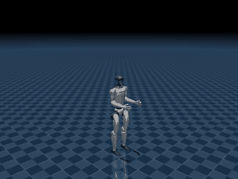

# Unitree G1 Reinforcement Learning - Placement Portfolio

**Haoyan Xu | TUS Robotics Research Laboratory**

A selected portfolio from my 24-week university industrial placement at the Technological University of the Shannon, under the supervision of Dr Yuansong Qiao. The project explored reinforcement-learning-based humanoid control and simulation workflows for the Unitree G1.

[Watch the original MP4](media/G1_MuJoCo_Demo.mp4) | [Read the two-page project showcase](docs/Haoyan_Xu_G1_Project_Showcase.pdf)

## My work

My placement work focused on task and training configuration, running and diagnosing experiments, exporting a recurrent policy, and preparing its MuJoCo replay. Practical issues included reward balance, environment compatibility, and headless rendering. Implementation and troubleshooting were AI-assisted. The reinforcement-learning algorithms, robot models, and core simulator interfaces were provided by existing open-source frameworks.

Two stages are represented here:

- **mjlab configuration work:** a historical custom-task configuration demonstrates adjustments to reward weights, termination settings, and a velocity curriculum.
- **Isaac Gym to MuJoCo workflow:** G1 configuration, recurrent-policy export, and an EGL video-recording script support the preserved demonstration below.

## Demonstrated result

One recorded MuJoCo replay ran for **10.0 seconds of simulation time** at a commanded forward velocity of **0.5 m/s**. The retained run output records a final base position of **x = 4.081 m, y = 0.296 m, z = 0.756 m**, with the robot upright at the end. Its initial forward position was approximately zero; dividing forward displacement by the simulation duration gives approximately **0.41 m/s for this one run**.

The MP4 has an encoded duration of about 10.4 seconds because frames were sampled and encoded separately from the simulation clock. This is a single simulation demonstration, not a repeated-trial average, measured fall-rate benchmark, or physical-robot deployment. All results presented here are simulation-only.

## Selected materials

| Material | Purpose |
| --- | --- |
| [Two-page showcase](docs/Haoyan_Xu_G1_Project_Showcase.pdf) | Project context, responsibilities, workflow, and result |
| [Original demonstration video](media/G1_MuJoCo_Demo.mp4) | Preserved G1 MuJoCo replay |
| [G1 training configuration](code/unitree_rl_gym/g1_config.py) | Configuration snapshot from Unitree RL GYM |
| [MuJoCo deployment configuration](code/unitree_rl_gym/g1.yaml) | Configuration used with an explicit policy override |
| [EGL recording script](code/unitree_rl_gym/record_video.py) | Recurrent-policy playback and video capture |
| [Historical mjlab configuration](code/mjlab_historical/g1_custom.py) | Earlier task-configuration example; see its provenance note |
| [Run record](evidence/mujoco_run.txt) | Short retained output excerpt and result calculation |
| [Exported recurrent policy](models/policy_lstm_1.pt) | Retained TorchScript policy; see the [model note](models/README.md) |

These are selected project artifacts rather than a complete training distribution. The exported recurrent policy is retained here; the original training checkpoint was not recovered and is not included, and complete training logs are not included. No new model licence has been assigned. The historical mjlab configuration is a separate stage and does not establish the performance of the MuJoCo demonstration.

## Framework acknowledgements

- [Unitree RL GYM](https://github.com/unitreerobotics/unitree_rl_gym): G1 training/deployment structure and configurations; BSD 3-Clause.
- [legged_gym](https://github.com/leggedrobotics/legged_gym) and [rsl_rl](https://github.com/leggedrobotics/rsl_rl): environment/training infrastructure and reinforcement-learning implementation used by that framework.
- [mjlab](https://github.com/mujocolab/mjlab): APIs used by the historical configuration sample.
- [MuJoCo](https://github.com/google-deepmind/mujoco) and NVIDIA Isaac Gym: simulation platforms used during the placement.

See [third-party notices](THIRD_PARTY_NOTICES.md) for source and licensing details. No endorsement by these organisations is implied.
